<!-- ═══════════════════════════════════════════════════════════
     GitHub Profile README  –  Ayush Patel
     ═══════════════════════════════════════════════════════════ -->

<!-- ── HERO: ASCII PORTRAIT + 3D WORDMARK ──────────────────── -->
<table border="0" cellspacing="0" cellpadding="0">
<tr>
<td width="370" valign="middle" align="center">
  
</td>
<td width="20"></td>
<td width="490" valign="middle" align="center">
  
</td>
</tr>
</table>

<!-- ── PROFESSIONAL INTRODUCTION ───────────────────────────── -->
<h1>Hi, I'm Ayush Patel</h1>

  <strong>B.Tech CSE (Cloud Computing &amp; Information Security) · Cloud, DevOps &amp; Generative AI Engineer</strong> 
  Passionate about turning challenges into opportunities through cloud and security innovation.

  Focused on building scalable <strong>AWS cloud architectures</strong>, containerized <strong>Docker</strong> workflows,
  <strong>Python</strong> backends, secure systems, and <strong>LLM / RAG</strong> applications.

  
  &nbsp;
  
  &nbsp;
  
  &nbsp;
  

---

## About Me

- **Education:** Pursuing **B.Tech in Computer Science Engineering (Cloud Computing & Information Security)** at *Sandip University, Nashik* (`2024–2027`, GPA: `8.57`) following a **Diploma in Computer Science** from *Gov. Polytechnic College, Itarsi* (`2021–2024`, GPA: `7.4`).
- **Industry Experience:** Software Developer Intern at **Miraiyantra Pvt. Ltd** (Nashik) and Cloud Developer Intern at **Ediglobe** (Pune, `2025`).
- **Hackathon Winner:** **ML Nashik Hackathon Champion 2026** (*Build with Gemma*) for designing and deploying an **ML Interviewer** powered by Gemma LLM and RAG architecture.
- **Security Training:** Completed the **Cyber Security Certificate Program** at **IIT Jodhpur** (`Oct 2023 – Jan 2024`), covering network security, ethical hacking, and threat analysis.
- **Career Focus:** Seeking roles in **Cloud Engineering (AWS)**, **DevOps**, **Cybersecurity / DevSecOps**, **Python Development**, and **Generative AI / RAG Systems**.

---

## Core Tech Stack

### Programming Languages

  
  &nbsp;
  

### Cloud & Infrastructure

  
  &nbsp;
  
  

### DevOps & Automation

  

### AI & Generative AI

  
  
  
  
  

### Web Development & Backend

  
  &nbsp;
  
  

### Cybersecurity & Networking

  
  
  
  

### Tools & Productivity

  
  
  
  
  
  

> **Familiar / Explored in GitHub Projects:** TypeScript · Next.js · PostgreSQL · Terraform (`terraform-ec2-instance`)

---

## Professional Experience

### Software Developer Intern — **Miraiyantra Pvt. Ltd**
*Nashik, Maharashtra*
- **Technologies:** React.js, Frontend & Backend Integration, Git, GitHub
- **Responsibilities & Contributions:**
  - Developed and maintained responsive web applications using modern web technologies.
  - Collaborated closely with frontend and backend teams to implement and test new application features.
  - Supported live application deployment, troubleshooting, and bug fixing to maintain service reliability.
  - Maintained clean version control and collaborative development workflows using Git and GitHub.

### Cloud Developer Intern — **Ediglobe**
*Pune, Maharashtra* | *2025*
- **Technologies:** AWS, Cloud Deployment, Linux, Shell Scripting, Automation
- **Responsibilities & Contributions:**
  - Developed and deployed cloud-based solutions designed for scalable application workloads.
  - Assisted in configuring cloud infrastructure and optimizing cloud resource utilization.
  - Collaborated with engineering peers on automation scripts and cloud service integrations.

---

## Featured Projects

<table>
  <tr>
    <td width="50%" valign="top">
      <h3>1. ML Interviewer (Build with Gemma)</h3>
      
<strong>Problem:</strong> Technical interview prep lacks adaptive, domain-grounded feedback.

      
<strong>Solution:</strong> Built an AI-powered ML interviewer leveraging <strong>Gemma LLM</strong> and <strong>RAG architecture</strong> for context-aware technical questioning and deployment.

      

        
        
        
      

      

        <strong>ML Nashik Hackathon Champion 2026</strong> 
        <a href="https://github.com/Ayushpate2003/ml-interviewer">Repository: Ayushpate2003/ml-interviewer</a>
      

    </td>
    <td width="50%" valign="top">
      <h3>2. AWS Cloud & EC2 Infrastructure</h3>
      
<strong>Problem:</strong> Manual cloud server and storage provisioning slows down deployments and causes configuration drift.

      
<strong>Solution:</strong> Implemented scalable hosting and storage workflows using <strong>AWS EC2</strong> and <strong>S3</strong>, alongside repeatable EC2 provisioning.

      

        
        
        
      

      

        <a href="https://github.com/Ayushpate2003/terraform-ec2-instance">Repository: Ayushpate2003/terraform-ec2-instance</a>
      

    </td>
  </tr>
  <tr>
    <td width="50%" valign="top">
      <h3>3. Docker-Based Projects & OpenDuty</h3>
      
<strong>Problem:</strong> Environment inconsistencies ("works on my machine") and slow incident runbook execution.

      
<strong>Solution:</strong> Containerized multi-service applications with <strong>Docker</strong> for reproducible environments, including a self-hosted incident response &amp; runbook automation platform.

      

        
        
        
      

      

        <a href="https://github.com/Ayushpate2003/OpenDuty">Repository: Ayushpate2003/OpenDuty</a>
      

    </td>
    <td width="50%" valign="top">
      <h3>4. Krishi-Drishti (Sun Hack 2025)</h3>
      
<strong>Problem:</strong> Rural farmers face unreliable internet connectivity and lack accessible crop-optimization tools.

      
<strong>Solution:</strong> Built an offline-first agricultural platform to help farmers optimize crop growth with reliable deployment.

      

        
        
        
      

      

        <a href="https://github.com/Ayushpate2003/sunhack">Repository: Ayushpate2003/sunhack</a>
      

    </td>
  </tr>
  <tr>
    <td width="50%" valign="top">
      <h3>5. AI Document Generator</h3>
      
<strong>Problem:</strong> Drafting structured technical and business documents manually is time-consuming.

      
<strong>Solution:</strong> Python-based AI document generation tool automating structured document creation using LLM workflows.

      

        
        
      

      

        <a href="https://github.com/Ayushpate2003/Ai-doc-generater">Repository: Ayushpate2003/Ai-doc-generater</a>
      

    </td>
    <td width="50%" valign="top">
      <h3>6. SecureOps — AI DevSecOps Platform</h3>
      
<strong>Problem:</strong> Security findings across CI/CD scanners are fragmented and hard to triage.

      
<strong>Solution:</strong> Aggregates findings from industry-standard tools (<strong>Trivy</strong>, <strong>Gitleaks</strong>, <strong>Semgrep</strong>) into a unified security posture and remediation workflow.

      

        
        
      

      

        <a href="https://github.com/Ayushpate2003/SecureOps---AI-DevSecOps-Platform">Repository: Ayushpate2003/SecureOps</a>
      

    </td>
  </tr>
</table>

- **Skill Hub Quiz Website** *(2023)* — Built an interactive quiz platform and managed application testing, deployment, and troubleshooting.

---

## Achievements

- **ML Nashik Hackathon Champion 2026** — *Build with Gemma*: Designed and implemented an **ML Interviewer** using Gemma LLM and RAG architecture under competitive hackathon constraints.
- **Sun Hack Hackathon (2025)** — Built and deployed **Krishi-Drishti**, an offline-first platform for rural farmers.
- **Skill Hub Quiz Website (2023)** — End-to-end software development, testing, and deployment.

## Certifications

- **Cyber Security Certificate Program** — **IIT Jodhpur** (`Oct 2023 – Jan 2024`)
  - Intensive training in network security, ethical hacking, secure system practices, and real-world threat analysis.

## Education

- **B.Tech in Computer Science Engineering** *(Specialization: Cloud Computing & Information Security)*
  - *Sandip University, Nashik* · `Oct 2024 – Apr 2027` · **GPA: `8.57`**
- **Diploma in Computer Science**
  - *Gov. Polytechnic College, Itarsi, Madhya Pradesh* · `Sept 2021 – Apr 2024` · **GPA: `7.4`**

---

## GitHub Statistics

  
  &nbsp;
  

  

 

---

## Connect With Me

  
  &nbsp;
  
  &nbsp;
  
  &nbsp;
  

Contribution heatmap refreshes automatically every day via GitHub Actions.

